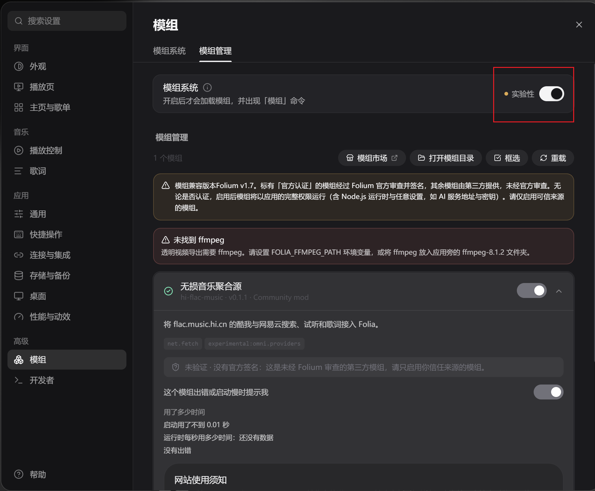
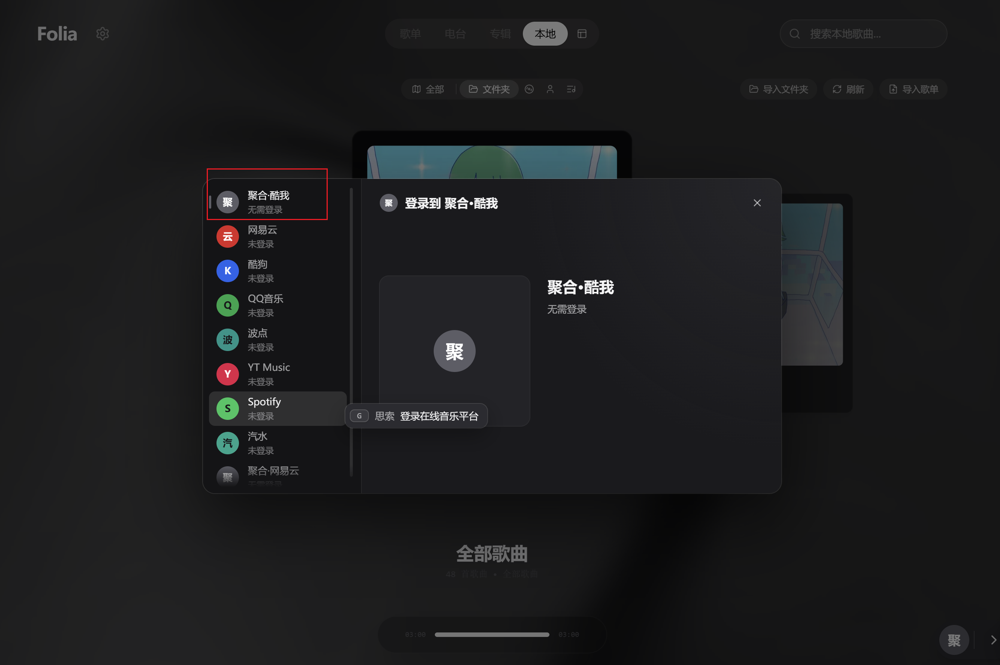
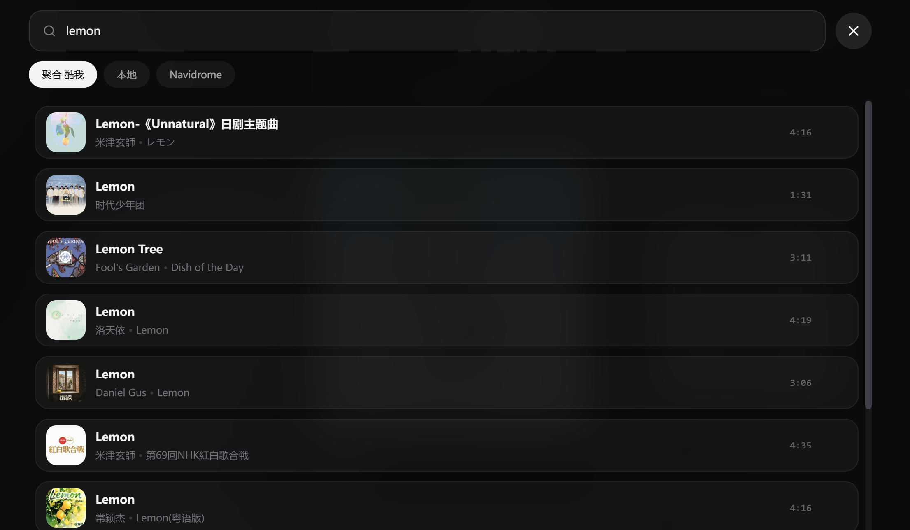

# 无损音乐聚合源 · Folium Mod

将 [flac.music.hi.cn](https://flac.music.hi.cn/) 的公开前端搜索接口接入 Folia，注册两个独立在线音源：

- 无损音乐聚合 · 酷我（`kuwo`）
- 无损音乐聚合 · 网易云（`wyy`）

当前实现范围：

- 歌曲搜索与分页
- 通过网站正常的 `song` / `getUrl` 流程获取在线试听地址
- 通过网站正常的 `getLyric` 流程获取 LRC 歌词
- Folia 设置中展示网站作者的使用说明与口令获取要求

当前不实现：

- 下载功能或下载按钮
- 自动输入/获取/验证口令
- 自动模拟快手助力、跳过网站验证或绕过访问限制
- 专辑、歌单、艺人浏览
- Hi-Res 音质承诺（网站没有提供可验证的采样率/位深信息）

## 安装

<table>
  <tr>
    <td align="center"> 启用模组功能</td>
    <td align="center"> 选择音源</td>
  </tr>
  <tr>
    <td align="center"> 搜索歌曲</td>
    <td align="center"> 播放歌曲</td>
  </tr>
</table>

1. 在 Folia 中打开「设置 → 模组 → 模组系统」，启用模组系统。
2. 打开模组管理面板。
3. 将本模组目录打包成 ZIP，或将 ZIP 拖入模组面板安装。
4. 在风险确认窗口中检查权限和代码，确认启用。
5. 在 Folia 的在线音源切换器中选择「聚合·酷我」或「聚合·网易云」。
6. 在「设置 → 模组 → 无损音乐聚合源 → 网站使用须知」查看网站作者要求。

## 技术说明

模组通过 Folium 的 `folium.net.fetch` 向 `https://flac.music.hi.cn/ajax.php?act=...` 发送表单 POST 请求。`net.fetch` 需要 `net.fetch` 权限；自定义在线音源使用实验接口 `experimental: ["omni.providers"]`。

音源服务的请求动作来自网站公开前端使用的接口：

- `search`: `platform`, `keyword`, `page`, `size`
- `song`: `platform`, `id`
- `getUrl`: `platform`, `songid`, `format`, `bitrate`, `time`, `sign`
- `getLyric`: `platform`, `songid`, `time`, `sign`

网站接口和 Folium 实验接口都可能变化。此模组目前属于早期适配版本，尚未在真实 Folia 桌面应用中做端到端播放验证。
